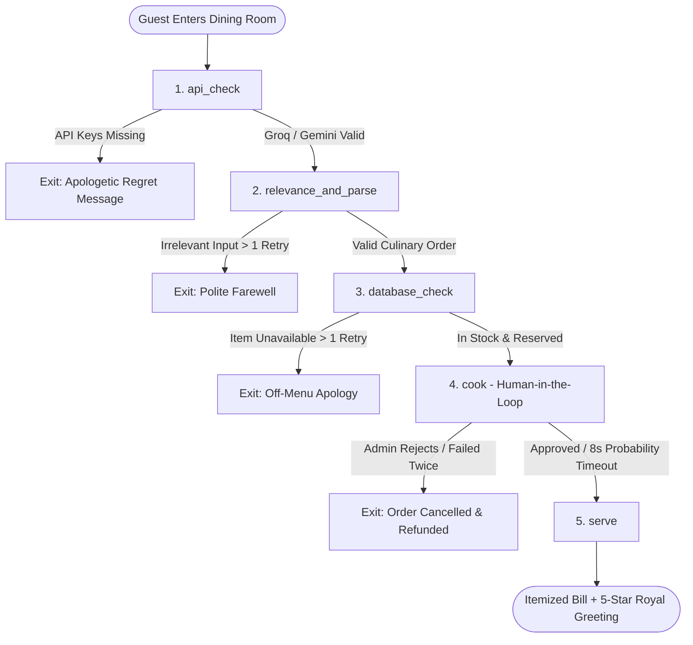

# 🍽️ L'Étoile Royale • Autonomous Restaurant Agent

[](https://www.python.org/)
[](https://fastapi.tiangolo.com/)
[](https://github.com/langchain-ai/langgraph)
[](https://www.mongodb.com/)
[](https://www.docker.com/)
[](LICENSE)

An enterprise-grade, agentic restaurant workflow automation platform powered by **LangGraph**, **LangChain**, and **MongoDB**. Designed with a 5-star Michelin luxury aesthetic (**L'Étoile Royale**), the system orchestrates conversational order parsing, atomic inventory validation, Human-in-the-Loop (HITL) kitchen cook verification with automated probability fallbacks, and 24-hour automated pantry replenishment.

---

## 🏛️ System Architecture

The workflow is modeled as a cyclic state machine utilizing **LangGraph**:



---

## 🌟 Key Features

### 1. 🤖 Dual-Engine LLM Resilience
- Primary engine: **Groq (`openai/gpt-oss-20b`)** for ultra-fast, structured culinary extraction.
- Automatic fallback: **Google Gemini (`gemini-4-hydrogen`)** if Groq quotas or rate limits trigger.
- Offline heuristics fallback to guarantee zero service interruption during testing or network cutoffs.

### 2. ⏱️ 8-Second Human-in-the-Loop (HITL) Chef Countdown
- Kitchen cooking tickets trigger a LangGraph execution pause via `interrupt()`.
- **Live Chef Console**: Executive chefs can manually inspect tickets and click **Approve** or **Fail**.
- **Autonomous Probability Resolution**: If the chef is away and does not respond within **8 seconds**, the system automatically resolves the decision based on empirical culinary probability (**85% Approval / 15% Failure**), keeping kitchen turnaround rapid without deadlocking orders.

### 3. 📦 24-Hour Automated Inventory Replenishment
- Scheduled background daemon checks ingredient levels every 24 hours.
- If pantry stock falls below threshold levels (less than 5 units), it automatically replenishes items back to nominal stock levels (25 units) and logs the replenishment timestamp in MongoDB.

### 4. 🥂 5-Star Michelin Dual-Portal Experience
- **Customer Dining Room (`/`)**: Natural language conversational concierge, live artisanal menu card, dynamic culinary pipeline tracker, and leather-embossed gold bill receipt.
- **Executive Kitchen & Chef Console (`/admin`)**: Active cooking tickets with live countdown rings, manual override buttons, real-time pantry inventory editor, and smart order history.
- **☀️ Day & 🌙 Night Ambience**:
  - *Night Mode (Caviar Noir & Champagne Gold)*: Deep noir background, warm glowing borders, and gold accents.
  - *Day Mode (L'Étoile Ivory & Antique Bronze)*: Italian alabaster marble, antique bronze trims, and dark espresso typography.

### 5. 🔍 Smart Order Querying
- Displays orders placed on the **present day**.
- If no orders were placed today, automatically displays the **most recent 15 orders** from MongoDB history.

---

## 📁 Repository Structure

```
restaurantAgent/
├── backend/
│   ├── db.py                 # MongoDB repository (PyMongo + 24h restock + atomic updates)
│   ├── llm_service.py        # Dual-API fallback (Groq + Gemini + structured JSON extraction)
│   ├── restaurant_agent.py   # LangGraph state machine with HITL interrupt() & checkpointer
│   ├── server.py             # FastAPI REST endpoints & static asset mounting
│   ├── test_scenarios.py     # End-to-end automated test runner for all 7 branch scenarios
│   ├── test_hitl_timeout.py  # Verification script for 8s timer + probability fallback
│   ├── test_restock_check.py # Verification script for 24h pantry replenishment
│   └── .env                  # API keys and connection parameters (git-ignored)
├── frontend/
│   ├── index.html            # Customer Dining Room portal
│   ├── customer.js           # Customer portal controller & live order poller
│   ├── admin.html            # Executive Kitchen & Chef Console
│   ├── admin.js              # Chef console controller, countdown timer & inventory manager
│   └── styles.css            # 5-star Michelin luxury design system (Day & Night themes)
├── .env.example              # Environment variable configuration template
├── .gitignore                # Production ignore rules (excludes keys, caches, DBs)
├── Dockerfile                # Production Python 3.12 container image
├── docker-compose.yml        # Multi-container orchestration (FastAPI + MongoDB)
├── Procfile                  # Platform entrypoint (Render)
├── render.yaml               # Render.com blueprint configuration
├── requirements.txt          # Python runtime dependencies
└── README.md                 # Complete documentation
```

---

## 🍃 MongoDB Schema

### Menu Collection (`menu`)
```json
{
  "_id": "67420a...",
  "item_id": 1,
  "name": "Cheese Burger",
  "category": "Mains",
  "price": 8.99,
  "stock": 15,
  "last_restocked": "2026-11-23T14:00:00.000000"
}
```

### Orders Collection (`orders`)
```json
{
  "_id": "ORD-0001",
  "order_id": "ORD-0001",
  "items": [
    {
      "name": "Cheese Burger",
      "price": 8.99,
      "quantity": 2,
      "item_total": 17.98
    }
  ],
  "total_amount": 17.98,
  "tax_amount": 0.90,
  "grand_total": 18.88,
  "status": "SERVED",
  "created_at": "2026-11-23T14:23:24.000000",
  "updated_at": "2026-11-23T14:23:32.000000"
}
```

---

## 🚀 Getting Started

### Option A: Run with Docker Compose (Recommended)

1. **Start Docker Desktop** on your machine.
2. Clone the repository and navigate to the project directory:
   ```bash
   git clone https://github.com/your-username/restaurant-agent.git
   cd restaurant-agent
   ```
3. Copy environment variables:
   ```bash
   cp .env.example backend/.env
   # Add your GROQ_API_KEY or GEMINI_API_KEY in backend/.env
   ```
4. Build and start both the **FastAPI app** and **MongoDB database** containers:
   ```bash
   docker compose up --build
   ```
5. Open your browser:
   - 🥂 **Customer Dining Room:** [http://localhost:8000/](http://localhost:8000/)
   - 👨‍🍳 **Executive Kitchen Console:** [http://localhost:8000/admin](http://localhost:8000/admin)

To stop the containers:
```bash
docker compose down
```

---

### Option B: Run Locally with Python

1. **Prerequisites:** Python 3.12+ and MongoDB running on `localhost:27017` (or the system falls back to in-memory `mongomock`).
2. **Create Virtual Environment:**
   ```bash
   python -m venv venv
   source venv/bin/activate  # On Windows: venv\Scripts\activate
   ```
3. **Install Dependencies:**
   ```bash
   pip install -r requirements.txt
   ```
4. **Configure `.env` in `backend/.env`:**
   ```env
   MONGO_URI=mongodb://localhost:27017
   MONGO_DB_NAME=restaurant_db
   GROQ_API_KEY=your_groq_api_key_here
   GEMINI_API_KEY=your_gemini_api_key_here
   ```
5. **Start the Server:**
   ```bash
   uvicorn backend.server:app --host 0.0.0.0 --port 8000 --reload
   ```

---

## 📡 REST API Reference

| Method | Endpoint | Description |
|---|---|---|
| `GET` | `/api/menu` | Fetch current menu with live stock availability |
| `POST` | `/api/order` | Submit natural language guest order to LangGraph |
| `GET` | `/api/order-status/{thread_id}` | Poll current order state, status, bill, or active interrupts |
| `POST` | `/api/resume` | Resume cooking ticket (`approved` / `failed`) |
| `GET` | `/api/pending-reviews` | List orders waiting for Chef review (with remaining seconds) |
| `POST` | `/api/menu/update-stock` | Increment/decrement inventory for a specific dish |
| `POST` | `/api/restock` | Trigger instantaneous 24-hour pantry replenishment |
| `GET` | `/api/orders` | Query orders (today's orders or recent 15 fallback) |

---

## 🧪 Automated Test Suite

Run the full end-to-end validation test suite verifying all 7 branch scenarios, 8s timeout resolution, and inventory auto-restock:

```bash
# 1. Test all 7 LangGraph flow scenarios
python backend/test_scenarios.py

# 2. Test 8-second HITL countdown & probabilistic fallback
python backend/test_hitl_timeout.py

# 3. Test 24-hour automatic inventory replenishment
python backend/test_restock_check.py
```

### Verified Test Scenarios:
- ✅ **Scenario 1:** Complete happy path (Order -> Check DB -> Cook Approved -> Serve & Bill).
- ✅ **Scenario 2:** Irrelevant input with successful second-attempt recovery.
- ✅ **Scenario 3:** Irrelevant input rejected twice -> Clean exit.
- ✅ **Scenario 4:** Off-menu dish re-routed to valid menu item.
- ✅ **Scenario 5:** Off-menu dish twice -> Apologetic exit.
- ✅ **Scenario 6:** Cooking failure recovered on remake -> Successful Serve.
- ✅ **Scenario 7:** Double cooking failure -> Cancellation & refund.
- ✅ **Scenario 8:** 8-second countdown timer expiration -> 85%/15% probability auto-approval.

---

## ☁️ Cloud Deployment

### Deploy to Render
1. Push this repository to GitHub.
2. In [Render Dashboard](https://dashboard.render.com/), click **New** -> **Blueprint**.
3. Select this repository (Render uses `render.yaml`).
4. Set `GROQ_API_KEY` or `GEMINI_API_KEY` and `MONGO_URI` under Environment Variables.

### Deploy to Railway
1. Click **New Project** -> **Deploy from GitHub repo**.
2. Railway detects the `Dockerfile` or `Procfile` automatically.
3. Add a **MongoDB Plugin** service in the same project and link `MONGO_URI`.

---

## 📜 License
Distributed under the MIT License. See `LICENSE` for details.
